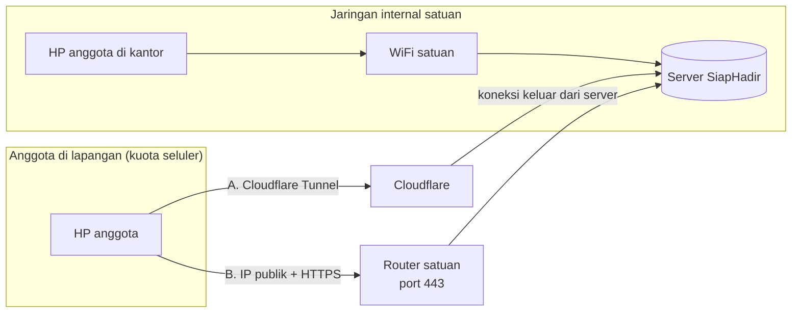

# SiapHadir

Aplikasi absensi dan papan apel untuk satuan dengan pola kerja dinamis: hadir di kantor, piket, tugas lapangan, dinas luar, BKO, BP, pendidikan, cuti, izin, sakit.

- **Anggota** melapor sendiri dari HP (APK Android atau web), dari ruang kerja maupun di lapangan.
- **Pimpinan/admin** cukup membuka aplikasi: papan apel, laporan kekuatan siap kirim WhatsApp, dan rekap bulanan terisi sendiri.
- **Privasi lokasi**: GPS hanya diambil **satu kali saat melapor, pada jam dinas**. Di luar jam dinas server menolak menyimpan lokasi. Selama "keperluan mendadak", lokasi dijeda dan keterangan wajib diisi.
- Data tersimpan di **server milik satuan sendiri** (satu file database SQLite).

Nama satuan, logo, video pembuka, dan jam dinas diatur dari dalam aplikasi (menu Pengaturan), sehingga satu aplikasi bisa dipakai satuan mana pun.

---

## 1. Skema untuk anggota (yang perlu dijelaskan saat sosialisasi)

| Kapan | Siapa | Yang dilakukan |
|---|---|---|
| Sekali | Admin | Bagikan file APK di grup, lalu kirim **NRP + PIN awal** ke tiap anggota secara pribadi |
| Sekali | Anggota | Pasang APK → isi alamat server → masuk dengan NRP + PIN → buat PIN pribadi |
| Tiap hari kerja | Anggota | HP mengingatkan 15 menit sebelum jam dinas → buka aplikasi → ketuk status → selesai |
| Bila perlu | Anggota | Cuti/BKO/DL beberapa hari: isi sekali dengan "Berlaku sampai" |
| Bila perlu | Anggota | Keluar mendadak saat jam dinas: tekan **Keperluan mendadak**, tulis alasan, lalu **Sudah kembali** |
| Kapan saja | Pimpinan | Buka aplikasi: papan apel, laporan kekuatan, rekap |

Pengguna iPhone tidak bisa memasang APK. Mereka membuka alamat server di Safari, lalu **Bagikan → Tambah ke Layar Utama**. Isinya sama.

---

## 2. Skema server di jaringan internal satuan

Server cukup satu komputer di ruang satuan. Masalah utamanya: **anggota di lapangan memakai kuota seluler**, jadi HP mereka harus bisa menjangkau server dari internet. Ada empat pilihan:



| Pilihan | Cara kerja | Kelebihan | Kekurangan |
|---|---|---|---|
| **A. Cloudflare Tunnel** | Program `cloudflared` di server membuka sambungan keluar ke Cloudflare; anggota mengakses lewat domain HTTPS | Tidak perlu IP publik, tidak perlu membuka port router, HTTPS gratis. Paling mudah. | Lalu lintas lewat pihak ketiga (Cloudflare). Perlu domain (berbayar per tahun) [CEK]. Perlu persetujuan pengamanan satuan. |
| **B. IP publik + HTTPS** | Router satuan meneruskan port 443 ke server; Caddy membuat sertifikat HTTPS otomatis | Data langsung ke server satuan, tanpa perantara | Perlu IP publik statis dari ISP, domain, dan pengaturan firewall/router |
| C. Hanya intranet | Server hanya bisa diakses dari WiFi satuan | Paling tertutup | **Anggota di lapangan tidak bisa absen.** Tidak memenuhi kebutuhan |
| D. VPN | Setiap HP memasang aplikasi VPN ke jaringan satuan | Sangat aman | Merepotkan anggota; sering lupa menyalakan VPN |

**Rekomendasi**: B bila satuan punya IP publik statis dan izin dari bagian pengamanan/Hubdam; jika tidak, A. Keputusan ini sebaiknya dikonsultasikan ke pejabat pengamanan informasi satuan.

GPS dan aplikasi APK **wajib HTTPS**. Tanpa HTTPS, browser dan Android menolak mengambil lokasi.

### Kebutuhan perangkat
- PC atau mini PC: CPU 2 inti, RAM 4 GB, SSD 64 GB (cukup untuk ratusan personel)
- Ubuntu Server 24.04 LTS
- UPS (agar database tidak rusak saat listrik padam)
- Flashdisk/HDD eksternal untuk cadangan harian

---

## 3. Pemasangan server (untuk operator)

```bash
# 1. Pasang Node.js 22 (bawaan node:sqlite, tanpa paket tambahan)
curl -fsSL https://deb.nodesource.com/setup_22.x | sudo bash -
sudo apt-get install -y nodejs sqlite3

# 2. Salin folder siaphadir ke /opt/siaphadir, lalu uji
cd /opt/siaphadir/server && npm test

# 3. Jalankan sebagai layanan
sudo tee /etc/systemd/system/siaphadir.service >/dev/null <<'UNIT'
[Unit]
Description=SiapHadir
After=network.target
[Service]
WorkingDirectory=/opt/siaphadir/server
Environment=PORT=8080
Environment=DATA_DIR=/var/lib/siaphadir
Environment=TZ=Asia/Jakarta
ExecStart=/usr/bin/node --no-warnings server.js
Restart=always
User=www-data
[Install]
WantedBy=multi-user.target
UNIT
sudo mkdir -p /var/lib/siaphadir && sudo chown www-data /var/lib/siaphadir
sudo systemctl enable --now siaphadir
```

### HTTPS
- **Pilihan A (Cloudflare Tunnel)**: pasang `cloudflared`, buat tunnel ke `http://localhost:8080`, arahkan domain, misalnya `absen.satuan-anda.id`.
- **Pilihan B (Caddy)**: `sudo apt install caddy`, isi `/etc/caddy/Caddyfile` dengan:
  ```
  absen.satuan-anda.id {
      reverse_proxy localhost:8080
  }
  ```
  Caddy membuat sertifikat HTTPS otomatis.
- Bisa juga memakai sertifikat sendiri: set `TLS_CERT` dan `TLS_KEY` ke file sertifikat, lalu server berjalan langsung di HTTPS.

### Cadangan harian (cron)
```bash
sudo mkdir -p /backup/siaphadir
echo '30 23 * * * root sqlite3 /var/lib/siaphadir/siaphadir.db ".backup /backup/siaphadir/siaphadir-$(date +\%F).db"' | sudo tee /etc/cron.d/siaphadir-backup
```

### Variabel lingkungan
| Nama | Bawaan | Fungsi |
|---|---|---|
| `PORT` | 8080 | Port server |
| `DATA_DIR` | `server/data` | Lokasi database dan video pembuka |
| `TZ` | Asia/Jakarta | Zona waktu, penentu jam dinas |
| `CORS_ORIGINS` | `https://localhost,capacitor://localhost,http://localhost` | Asal yang boleh memanggil API (APK memakai `https://localhost`) |
| `SESSION_DAYS` | 180 | Lama anggota tetap masuk tanpa PIN |
| `TLS_CERT`, `TLS_KEY` | – | HTTPS langsung tanpa Caddy |

---

## 4. Penggunaan pertama
1. Buka alamat server di browser. Muncul **Siapkan aplikasi**: isi nama satuan dan data admin (PIN 6 angka).
2. **Pengaturan**: unggah logo satuan, atur jam dinas, dan (opsional) video pembuka.
3. **Personel → Tempel banyak sekaligus dari Excel**: kolom Pangkat, Nama, NRP, Jabatan. Aplikasi menampilkan PIN awal tiap personel **satu kali saja**. Salin dan bagikan secara pribadi.
4. Bagikan file APK. Anggota yang lupa PIN: **Personel → Kelola → Atur ulang PIN**.

---

## 5. Membangun APK
APK dibangun otomatis oleh GitHub Actions (`.github/workflows/siaphadir.yml`) setiap ada perubahan; unduh dari tab **Actions → SiapHadir → Artifacts**.

Membangun sendiri (perlu JDK 21 dan Android SDK 35):
```bash
cd siaphadir/mobile
npm ci
npm run apk     # hasil: android/app/build/outputs/apk/debug/app-debug.apk
```
Satu APK bisa dipakai banyak satuan, karena alamat server diisi saat pertama kali dibuka.

Untuk distribusi resmi, tanda tangani APK dengan kunci rilis sendiri (`./gradlew assembleRelease` dengan keystore). Simpan keystore baik-baik: tanpa keystore yang sama, pembaruan APK tidak bisa dipasang di atas versi lama.

---

## 6. Keamanan dan privasi
- PIN disimpan sebagai hash (scrypt). Setelah 5 kali salah, NRP dikunci 15 menit.
- Anggota hanya bisa mengisi absen dan biodata dirinya sendiri. Admin bisa mengisi untuk siapa pun.
- Koordinat GPS dan alasan keperluan mendadak hanya terlihat oleh yang bersangkutan dan admin.
- Biodata (alamat, kontak darurat, foto) hanya terlihat oleh pemiliknya dan admin.
- Semua perubahan tercatat di **Pengaturan → Riwayat aktivitas**.
- Personel yang dinonaktifkan langsung keluar dari semua HP-nya.

## 7. Struktur
```
siaphadir/
  server/   server.js (API + file web), test.js
  web/      aplikasi (satu file index.html), ikon, manifest
  mobile/   cangkang Android (Capacitor 7) → APK
```

## Lisensi dan penamaan
Kode SiapHadir ditulis baru dan terpisah dari proyek Attendify di repositori ini. Sebelum dijual, pindahkan folder `siaphadir/` ke repositori sendiri dan pastikan nama "SiapHadir" belum dipakai pihak lain [CEK merek].
